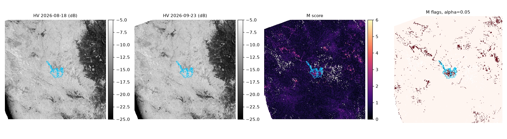
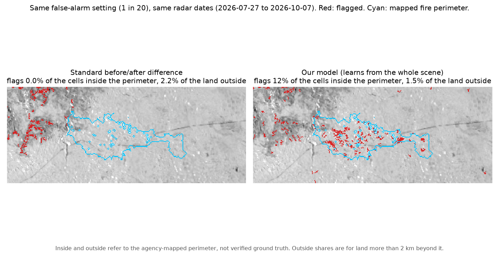
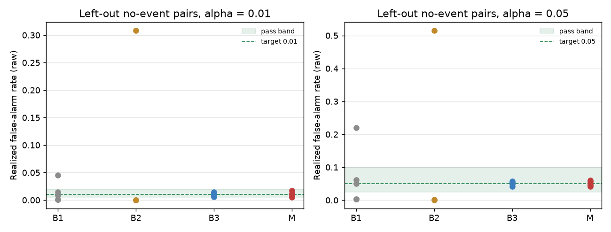

# Cold-start change detection for NISAR

NISAR's calibrated L-band record began on 17 June 2026. The best radar disturbance detectors
compare each pixel with years of its own history, which NISAR does not have yet. This project
replaces that history with the rest of the scene: a gradient-boosted quantile model learns, from
every pixel on the same two dates, how much backscatter change to *expect* for a cell given its
state before the event; cells that depart from that expectation are flagged at a false-alarm
rate fixed in advance by conformal calibration. We test it on two 2026 fires in Oregon against
three baselines, with the hypotheses for each committed before it was scored: McCully first,
then Austin as a pre-registered replication.

**Results.** On the McCully Fire both pre-registered hypotheses pass: set to flag half of the cells inside the fire perimeter, the model also flags 8.5% of the land more than 2 km outside it, against 12.8% for the best baseline. On the Austin Fire, a replication registered and pushed before its data were processed, the calibration result holds again (10 of 10 held-out checks within range) but the advantage does not: the model and the simpler land-type baseline tie (27.8% against 27.9%), while both clearly beat the standard log-ratio and short-history methods. The land-type baseline also calibrates almost as well (22 of 24 checks across both fires), so most of the calibration comes from comparing each place with similar land. This is a method for detecting radar-observed change at a controlled false-alarm rate, not a validated burn map.

**Live app:** https://nisar-coldstart.streamlit.app (precomputed results for the McCully and Austin fires; no login needed). Below the map, *Places to check first* ranks the flagged places, marks those that lie on fires agencies have already mapped, and moves the map to any place you select, with its radar history. An exploratory check added after the results: those other mapped fires were flagged 10 and 24 times as often as ordinary land (land-type baseline 10 and 11 times; standard log-ratio 3 and 0.4 times); see [Other mapped fires](#other-mapped-fires-an-exploratory-cross-check). If the app has gone to sleep, the wake-up button brings it back in about a minute.

## Reproduce

```bash
pip install -e .                                   # Python 3.11; exact versions are in requirements.lock
python -m coldstart run config/synthetic.yaml      # whole pipeline on simulated scenes, no credentials, ~4 min
streamlit run app/streamlit_app.py                 # opens the committed McCully and Austin results
```

The real site needs an Earthdata Login in `~/.netrc` (see [docs/DATA.md](docs/DATA.md)):

```bash
python scripts/fetch_perimeter.py config/site.yaml
python -m coldstart search config/site.yaml
python -m coldstart run config/site.yaml
```

The replication runs the same way with `config/site_austin.yaml`. `python scripts/flag_summary.py`, `python scripts/compare_figure.py` and `python scripts/other_fires.py` (same argument) rebuild the app's
per-setting summary, side-by-side figure and other-fire cross-check from stored outputs.

`pip install -e ".[test]"` then `pytest` runs the test suite (45 tests, about a minute and a half, offline).
`python scripts/exploratory.py config/site.yaml` reruns the ablations and robustness checks.

## Results: McCully Fire

Event pair 2026-08-18 to 2026-09-23 (NISAR track 077 A, frame 024); 4,292 cells inside the agency
fire perimeter ("burned" in the tables) and 490,753 control cells more than 2 km outside it, at
100 m (inside share 0.9%). Neither group was verified cell by cell: the perimeter encloses
unburned patches, and some control cells may have changed for other reasons, so every flag
outside counts as a false alarm here without being a confirmed error. Brackets: 95% block-bootstrap
intervals (5 km blocks, 500 resamples). Hypotheses frozen in commit `6994eb2` before scoring.

| Detector | FAR at 50% recall | Recall at 1% FAR | Average precision | F1 at α = 0.05 |
| --- | --- | --- | --- | --- |
| **M, pooled conditional model** | 0.085 [0.049, 0.165] | 0.183 [0.100, 0.254] | 0.066 [0.012, 0.147] | 0.175 |
| B3, stratified class shift | 0.128 [0.084, 0.231] | 0.132 [0.066, 0.189] | 0.044 [0.008, 0.099] | 0.133 |
| B2, short-baseline z-score | 0.150 [0.109, 0.267] | 0.050 [0.022, 0.084] | 0.028 [0.005, 0.063] | 0.077 |
| B1, log-ratio | 0.236 [0.171, 0.366] | 0.009 [0.003, 0.024] | 0.017 [0.003, 0.037] | 0.026 |

**H1: pass.** At 50% recall M raises fewer false alarms than every baseline, and every
M-minus-baseline interval lies below zero (against B3: -0.044 [-0.067, -0.032]).

**H3: pass.** Thresholds set on the other no-event pairs and applied to the one left out, for
α = 1% and 5%:

| Detector | Left-out checks within [α/2, 2α] | Realized rate at α = 0.05, range over pairs |
| --- | --- | --- |
| **M, pooled conditional model** | 14 of 14 | 0.044 to 0.070 |
| B3, stratified class shift | 12 of 14 | 0.041 to 0.061 |
| B2, short-baseline z-score | 1 of 10 | 0.007 to 0.248 |
| B1, log-ratio | 2 of 14 | 0.010 to 0.146 |

The pooled model's false-alarm rate is predictable from pair to pair; the log-ratio's swings
by a factor of fifteen. The land-type baseline is nearly as steady, so most of this comes from
normalizing each cell's change by what similar land did, which both share; the learned model adds
a little. Part of the pass is built into how the score is normalized
([docs/EVALUATION.md](docs/EVALUATION.md), section 2).

**What this does not show.** The burn's signal at 100 m on this date pair is modest, so
absolute performance is low for every detector: M's average precision is 0.066, about
8 times the inside share. At the default 1-in-20 setting M flags 38% of the cells inside the
perimeter, and most of its flags lie outside it. This is one fire on one track. See [docs/LIMITATIONS.md](docs/LIMITATIONS.md).




## Replication: Austin Fire (pre-registered)

The site, the event pair and every setting were fixed by rules written down in
[HYPOTHESES_REPLICATION.md](HYPOTHESES_REPLICATION.md), which was pushed to GitHub at 20:21:03
UTC on 15 November 2026 (GitHub's activity log) before any radar data for this site were
processed. `config/site_austin.yaml` differs from `config/site.yaml` only in the site-specific
fields.

Event pair 2026-07-27 to 2026-10-07 (NISAR track 106 A, frame 024); 4,841 cells inside
the perimeter and 458,923 control cells (inside share 1.0%). Brackets: 95%
block-bootstrap intervals.

| Detector | FAR at 50% recall | Recall at 1% FAR | Average precision |
| --- | --- | --- | --- |
| **M, pooled conditional model** | 0.278 [0.263, 0.320] | 0.069 [0.043, 0.078] | 0.027 [0.004, 0.055] |
| B3, stratified class shift | 0.279 [0.261, 0.326] | 0.027 [0.012, 0.038] | 0.019 [0.003, 0.041] |
| B2, short-baseline z-score | 0.471 [0.443, 0.498] | 0.001 [0.000, 0.004] | 0.010 [0.002, 0.021] |
| B1, log-ratio | 0.534 [0.501, 0.571] | 0.003 [0.001, 0.004] | 0.009 [0.002, 0.019] |

**H1: fail.** The model beats the log-ratio (-0.256 [-0.286, -0.210]) and the
short-history z-score (-0.193 [-0.218, -0.149]), but ties the land-type
baseline: -0.001 [-0.022, +0.009], an interval that includes zero.

**H3: pass.**

| Detector | Left-out checks within [α/2, 2α] | Realized rate at α = 0.05, range over pairs |
| --- | --- | --- |
| **M, pooled conditional model** | 10 of 10 | 0.042 to 0.060 |
| B3, stratified class shift | 10 of 10 | 0.042 to 0.057 |
| B2, short-baseline z-score | 0 of 6 | 0.001 to 0.515 |
| B1, log-ratio | 4 of 10 | 0.003 to 0.220 |

**Reading the two fires together.** The calibration result replicated: on both fires the
false-alarm setting held on every held-out check. The land-type baseline held on 22 of 24
checks across the two fires, so most of that comes from comparing each place with similar land,
which both methods do. The model's extra advantage over the land-type baseline, clear on
McCully, did not replicate on Austin at the pre-registered operating point. On secondary
measures reported by the same frozen evaluation (not part of H1), the model found more of the
inside at a 1% false-alarm rate (0.069 against 0.027;
difference +0.042 [+0.028, +0.049]) and ranked better overall (average precision
difference +0.007 [+0.001, +0.015]); these do not change the H1 verdict.

**What this does not show.** Detection on this pair is weak for every method: the model's
average precision is 0.027, about 2.5 times the inside share. At the
default 1-in-20 setting it flags 11.5% of the cells inside the perimeter and
1.5% of the land outside it (558 and 6,786 cells). The event pair
spans 72 days (McCully: 36), and the Grasshopper Fire overlaps the window's north-east edge,
inside one calibration pair; both were noted before processing.




## Other mapped fires: an exploratory cross-check

*Added after both fires were scored; not one of the pre-registered tests.* Every 2026 fire
perimeter that agencies mapped in each window, other than the studied fire, is already left out
of all scores (`truth.py`). `scripts/other_fires.py` records which fire each of those cells
belongs to, so the app can mark flagged places that touch one, and measures how often each
method flags them at the 1-in-20 setting, as mapped:

| Window | Method | Other mapped fires flagged | Ordinary land flagged | Ratio |
| --- | --- | --- | --- | --- |
| McCully (3,195 cells in other fires) | **M** | 27.2% | 2.6% | 10.4 |
| | B3, land-type | 25.4% | 2.6% | 9.6 |
| | B1, log-ratio | 6.5% | 2.2% | 3.0 |
| Austin (6,787 cells in other fires) | **M** | 35.5% | 1.5% | 24.0 |
| | B3, land-type | 29.9% | 2.8% | 10.8 |
| | B1, log-ratio | 0.9% | 2.2% | 0.4 |

On Austin the three largest places the model flags lie inside the Grasshopper Fire, which it was
never told about, and five of the six largest touch another mapped fire; the log-ratio flags
under 1% of the Grasshopper Fire. A prescribed burn from
April near McCully, before every date compared, is flagged by no method (0 of 215 cells).
Limits: the comparison was chosen after the results; perimeters are outlines, and when each
cell burned is not known; the Grasshopper Fire also burned during one Austin calibration pair,
which raises every method's threshold. The land-type baseline catches these fires nearly as
often as the model, so this check separates both of them from the standard methods, not from
each other.

## How it works

1. **Window.** The fire's bounding box plus 30 km, streamed from eleven NISAR GCOV scenes of one
   track (byte-range reads; about 0.4 GB per scene instead of 7.5 GB).
2. **Grid.** HH and HV averaged to 100 m cells in linear power, converted to dB; water, terrain
   outliers and missing cells masked.
3. **Pairs.** One event pair (last date before ignition, first date after the final perimeter
   update) and every consecutive pair of dates on one side of the fire (no-event pairs).
4. **Detectors.** B1 log-ratio; B2 per-pixel z-score on a short history; B3 change minus the
   land-class median; **M** cross-fitted quantile regression of change on earlier backscatter,
   polarization ratio, texture, terrain factor and land class.
5. **Calibration.** Thresholds from the no-event pairs, checked by leaving one pair out (H3).
6. **Evaluation.** Precision-recall against the NIFC perimeter; 5 km block bootstrap for
   intervals (H1).

Details and equations: [docs/METHODS.md](docs/METHODS.md). Hypotheses, frozen before scoring:
[HYPOTHESES.md](HYPOTHESES.md). Ablations, robustness and failure analysis:
[docs/EVALUATION.md](docs/EVALUATION.md). Independent audit: [docs/AUDIT.md](docs/AUDIT.md).

```text
ASF (NISAR GCOV) --> grid --> features --> detect (B1, B2, B3, M) --> calibrate --> evaluate --> export --> app
NIFC perimeter ---------------------------------------------------------------------^ (evaluation only)
```

The pipeline is offline and writes small files; the Streamlit app only reads them.

## What the radar shows, and why

- **Which polarizations?** Both. Scoring with HH or HV alone raised false alarms at 50% recall
  from 0.085 to about 0.145. On this burn HH changed at least as much as HV.
- **Physical drivers.** L-band penetrates the canopy and responds to branches, trunks and
  ground moisture. Inside the perimeter backscatter rose slightly by late September (HH +0.7 dB,
  HV +0.5 dB) and then fell faster than the surrounding land through October (HV -1.7 dB by 29
  October against -0.9 dB outside). We did not establish the cause; canopy loss exposing a
  rougher, wetter ground surface is one candidate.
- **What else moves?** Scene-wide shifts of half a decibel to a decibel between passes are
  routine (autumn wetting), and valley farmland changes by several decibels. Those are what a
  plain difference flags and the pooled model absorbs.

## Limits

Two fires, each on one track, are a small sample; the second reproduced the calibration result but
not the advantage over the land-type baseline. Real change outside the perimeter counts as false alarms;
unburned islands inside it cap recall. The conformal guarantee assumes calibration and event
cells are exchangeable. Rainfall (H2) was not tested. Full list:
[docs/LIMITATIONS.md](docs/LIMITATIONS.md).

## Who could use it

Nobody uses this operationally. The intended workflow is a triage aid for an analyst after an
event such as a fire:

1. Choose the area and the share of false alarms you can tolerate.
2. The map shows where NISAR's radar changed more than similar land in the same scene did.
3. Click a place to see its radar signal on every date beside the range the model expected.
4. Use the "Places to check first" list to decide where to look first. It marks the places that
   touch a fire agencies have already mapped, and can hide them, so unexplained change comes up
   first. Selecting a place moves the map to it and shows its radar history. Check each place
   against other imagery or on the ground. A flag is a detected change,
   not confirmed damage.

Before anyone relied on it, it would need testing on more events and sites, comparison with
burn-severity maps from optical imagery, and field checks of flagged and unflagged places.

## What comes next

- More events (floods, clearing, other fires), each with hypotheses frozen first.
- Rainfall and soil moisture as inputs, to test whether the advantage grows when weather
  differs between dates (H2, not tested here).
- Interferometric coherence alongside backscatter.
- Applying the GCOV validity mask, and labelling the largest false-alarm patches against
  optical imagery.

## Data credits

- NISAR L2 GCOV, provisional: NASA/JPL and ISRO, distributed by the Alaska Satellite Facility
  DAAC.
- Fire perimeters: National Interagency Fire Center, WFIGS Interagency Fire Perimeters.

## Third-party materials and their licences

Everything outside NASA and partner-agency data is open source or openly published.

| Material | Used for | Licence or terms |
| --- | --- | --- |
| NumPy, SciPy, pandas, scikit-learn, h5py, rasterio, shapely, asf_search | Pipeline | BSD |
| pyproj, PyYAML, Folium, streamlit-folium, pytest | Pipeline, app, tests | MIT |
| Streamlit, requests | App, perimeter download | Apache 2.0 |
| Matplotlib | Figures | Matplotlib licence (PSF-based) |
| NIFC WFIGS Interagency Fire Perimeters | Reference outline | Public U.S. interagency data; no licence stated, liability disclaimer applies |
| OpenStreetMap map tiles | App background map | Open Database License, © OpenStreetMap contributors |
| Esri World Imagery tiles | App background map (optional layer) | Esri terms of use; shown with Esri's attribution, not redistributed |

Exact versions are in `requirements.lock`.

## License

MIT, see [LICENSE](LICENSE).
