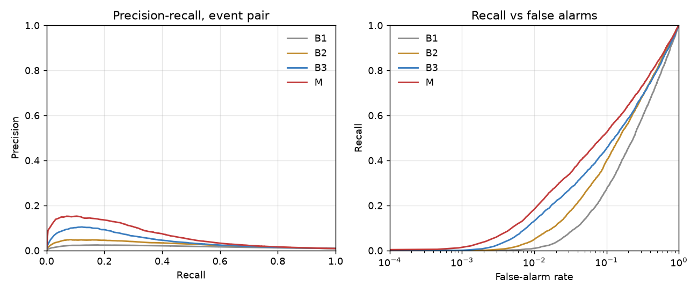
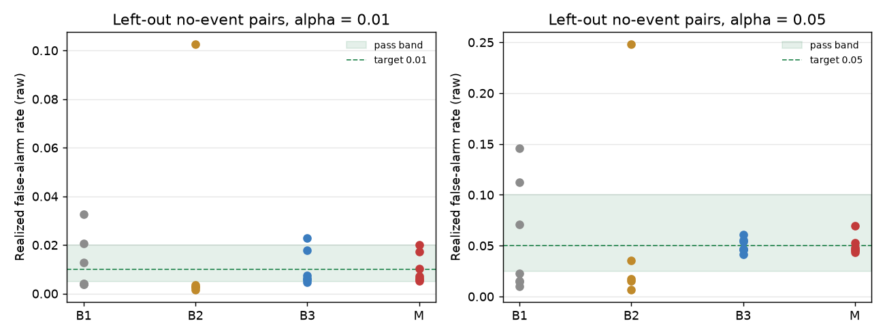

# Cold-start change detection for NISAR

NISAR's calibrated L-band record began on 17 June 2026. The best radar disturbance detectors
compare each pixel with years of its own history, which NISAR does not have yet. This project
replaces that history with the rest of the scene: a gradient-boosted quantile model learns, from
every pixel on the same two dates, how much backscatter change to *expect* for a cell given its
state before the event; cells that depart from that expectation are flagged at a false-alarm
rate fixed in advance by conformal calibration. We test it on the 2026 McCully Fire (Oregon)
against three baselines, with hypotheses committed before the fire was scored.

**Result on the McCully Fire:** both pre-registered hypotheses pass. Set to flag half of the cells inside the fire perimeter, the model also flags 8.5% of the land more than 2 km outside it, against 12.8% for the best baseline. On all 14 leave-one-pair-out checks its realized false-alarm rate stayed within half to double the target; the simpler land-type baseline managed 12 of 14, so most of that stability comes from normalizing by land type. This is a method for detecting radar-observed change at a controlled false-alarm rate, not a validated burn map.

**Live app:** https://nisar-coldstart.streamlit.app (precomputed results for the McCully Fire; no login needed)

## Reproduce

```bash
pip install -e .                                   # Python 3.11; exact versions are in requirements.lock
python -m coldstart run config/synthetic.yaml      # whole pipeline on simulated scenes, no credentials, ~4 min
streamlit run app/streamlit_app.py                 # opens the committed McCully results
```

The real site needs an Earthdata Login in `~/.netrc` (see [docs/DATA.md](docs/DATA.md)):

```bash
python scripts/fetch_perimeter.py config/site.yaml
python -m coldstart search config/site.yaml
python -m coldstart run config/site.yaml
```

`pip install -e ".[test]"` then `pytest` runs the test suite (35 tests, about a minute, offline).
`python scripts/exploratory.py config/site.yaml` reruns the ablations and robustness checks.

## Results: McCully Fire

Event pair 2026-08-18 to 2026-09-23 (NISAR track 077 A, frame 024); 4,292 cells inside the agency
fire perimeter ("burned" in the tables) and 490,753 control cells more than 2 km outside it, at
100 m (inside share 0.9%). Neither group was verified cell by cell: the perimeter encloses
unburned patches, and some control cells may have changed for other reasons, so every flag
outside counts as a false alarm here without being a confirmed error. Brackets: 95% block-bootstrap
intervals (5 km blocks, 500 resamples). Hypotheses frozen in commit `6994eb2` before scoring.

| Detector | FAR at 50% recall | Recall at 1% FAR | Average precision | F1 at α = 0.05 |
| --- | --- | --- | --- | --- |
| **M, pooled conditional model** | 0.085 [0.049, 0.165] | 0.183 [0.100, 0.254] | 0.066 [0.012, 0.147] | 0.175 |
| B3, stratified class shift | 0.128 [0.084, 0.231] | 0.132 [0.066, 0.189] | 0.044 [0.008, 0.099] | 0.133 |
| B2, short-baseline z-score | 0.150 [0.109, 0.267] | 0.050 [0.022, 0.084] | 0.028 [0.005, 0.063] | 0.077 |
| B1, log-ratio | 0.236 [0.171, 0.366] | 0.009 [0.003, 0.024] | 0.017 [0.003, 0.037] | 0.026 |

**H1: pass.** At 50% recall M raises fewer false alarms than every baseline, and every
M-minus-baseline interval lies below zero (against B3: -0.044 [-0.067, -0.032]).

**H3: pass.** Thresholds set on the other no-event pairs and applied to the one left out, for
α = 1% and 5%:

| Detector | Left-out checks within [α/2, 2α] | Realized rate at α = 0.05, range over pairs |
| --- | --- | --- |
| **M, pooled conditional model** | 14 of 14 | 0.044 to 0.070 |
| B3, stratified class shift | 12 of 14 | 0.041 to 0.061 |
| B2, short-baseline z-score | 1 of 10 | 0.007 to 0.248 |
| B1, log-ratio | 2 of 14 | 0.010 to 0.146 |

The pooled model's false-alarm rate is predictable from pair to pair; the log-ratio's swings
by a factor of fifteen. The land-type baseline is nearly as steady, so most of this comes from
normalizing each cell's change by what similar land did, which both share; the learned model adds
a little. Part of the pass is built into how the score is normalized
([docs/EVALUATION.md](docs/EVALUATION.md), section 2).

**What this does not show.** The burn's signal at 100 m on this date pair is modest, so
absolute performance is low for every detector: M's average precision is 0.066, about
8 times the inside share. At the default 1-in-20 setting M flags 38% of the cells inside the
perimeter, and most of its flags lie outside it. This is one fire on one track. See [docs/LIMITATIONS.md](docs/LIMITATIONS.md).





## How it works

1. **Window.** The fire's bounding box plus 30 km, streamed from eleven NISAR GCOV scenes of one
   track (byte-range reads; about 0.4 GB per scene instead of 7.5 GB).
2. **Grid.** HH and HV averaged to 100 m cells in linear power, converted to dB; water, terrain
   outliers and missing cells masked.
3. **Pairs.** One event pair (last date before ignition, first date after the final perimeter
   update) and every consecutive pair of dates on one side of the fire (no-event pairs).
4. **Detectors.** B1 log-ratio; B2 per-pixel z-score on a short history; B3 change minus the
   land-class median; **M** cross-fitted quantile regression of change on earlier backscatter,
   polarization ratio, texture, terrain factor and land class.
5. **Calibration.** Thresholds from the no-event pairs, checked by leaving one pair out (H3).
6. **Evaluation.** Precision-recall against the NIFC perimeter; 5 km block bootstrap for
   intervals (H1).

Details and equations: [docs/METHODS.md](docs/METHODS.md). Hypotheses, frozen before scoring:
[HYPOTHESES.md](HYPOTHESES.md). Ablations, robustness and failure analysis:
[docs/EVALUATION.md](docs/EVALUATION.md). Independent audit: [docs/AUDIT.md](docs/AUDIT.md).

```text
ASF (NISAR GCOV) --> grid --> features --> detect (B1, B2, B3, M) --> calibrate --> evaluate --> export --> app
NIFC perimeter ---------------------------------------------------------------------^ (evaluation only)
```

The pipeline is offline and writes small files; the Streamlit app only reads them.

## What the radar shows, and why

- **Which polarizations?** Both. Scoring with HH or HV alone raised false alarms at 50% recall
  from 0.085 to about 0.145. On this burn HH changed at least as much as HV.
- **Physical drivers.** L-band penetrates the canopy and responds to branches, trunks and
  ground moisture. Inside the perimeter backscatter rose slightly by late September (HH +0.7 dB,
  HV +0.5 dB) and then fell faster than the surrounding land through October (HV -1.7 dB by 29
  October against -0.9 dB outside). We did not establish the cause; canopy loss exposing a
  rougher, wetter ground surface is one candidate.
- **What else moves?** Scene-wide shifts of half a decibel to a decibel between passes are
  routine (autumn wetting), and valley farmland changes by several decibels. Those are what a
  plain difference flags and the pooled model absorbs.

## Limits

One fire on one track is one case study. Real change outside the perimeter counts as false alarms;
unburned islands inside it cap recall. The conformal guarantee assumes calibration and event
cells are exchangeable. Rainfall (H2) was not tested. Full list:
[docs/LIMITATIONS.md](docs/LIMITATIONS.md).

## Who could use it

Nobody uses this operationally. The intended workflow is a triage aid for an analyst after an
event such as a fire:

1. Choose the area and the share of false alarms you can tolerate.
2. The map shows where NISAR's radar changed more than similar land in the same scene did.
3. Click a place to see its radar signal on every date beside the range the model expected.
4. Use the flags to decide where to look first, then check them against other imagery or on the
   ground. A flag is a detected change, not confirmed damage.

Before anyone relied on it, it would need testing on more events and sites, comparison with
burn-severity maps from optical imagery, and field checks of flagged and unflagged places.

## What comes next

- More events (floods, clearing, other fires), each with hypotheses frozen first.
- Rainfall and soil moisture as inputs, to test whether the advantage grows when weather
  differs between dates (H2, not tested here).
- Interferometric coherence alongside backscatter.
- Applying the GCOV validity mask, and labelling the largest false-alarm patches against
  optical imagery.

## Data credits

- NISAR L2 GCOV, provisional: NASA/JPL and ISRO, distributed by the Alaska Satellite Facility
  DAAC.
- Fire perimeters: National Interagency Fire Center, WFIGS Interagency Fire Perimeters.

## Third-party materials and their licences

Everything outside NASA and partner-agency data is open source or openly published.

| Material | Used for | Licence or terms |
| --- | --- | --- |
| NumPy, SciPy, pandas, scikit-learn, h5py, rasterio, shapely, asf_search | Pipeline | BSD |
| pyproj, PyYAML, Folium, streamlit-folium, pytest | Pipeline, app, tests | MIT |
| Streamlit, requests | App, perimeter download | Apache 2.0 |
| Matplotlib | Figures | Matplotlib licence (PSF-based) |
| NIFC WFIGS Interagency Fire Perimeters | Reference outline | Public U.S. interagency data; no licence stated, liability disclaimer applies |
| OpenStreetMap map tiles | App background map | Open Database License, © OpenStreetMap contributors |
| Esri World Imagery tiles | App background map (optional layer) | Esri terms of use; shown with Esri's attribution, not redistributed |

Exact versions are in `requirements.lock`.

## License

MIT, see [LICENSE](LICENSE).
