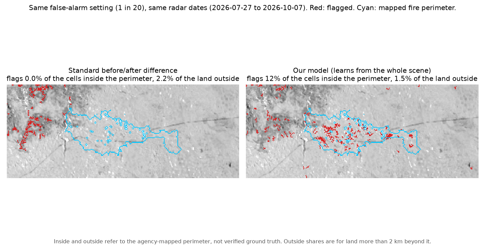
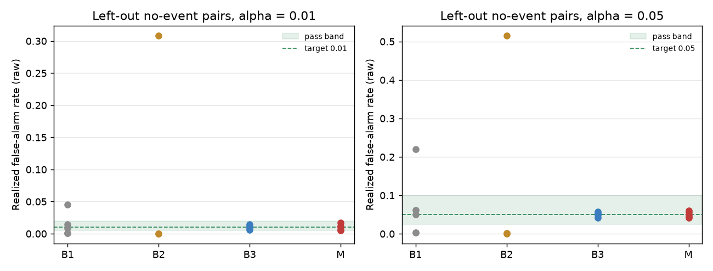

# Evaluation

Two kinds of result are kept apart here.

- **The frozen test** (H1, H3): hypotheses, settings and label rules were committed in `6994eb2`
  before the McCully event pair was scored. These are the claims.
- **Exploratory analysis**: everything in sections 3 to 7 was run after the result was known. It
  explains and stress-tests the result; it is not evidence for H1 or H3, and nothing in the
  frozen configuration was changed because of it.

Reproduce: `python -m coldstart run config/site.yaml` for sections 1 and 2, then
`python scripts/exploratory.py config/site.yaml` for sections 3 to 7. Numbers are in
`artifacts/mccully/metrics.json`, `calibration.json`, `failure_table.csv`, `exploratory.json`
and `false_alarm_patches.csv`.

## 1. Frozen test: H1

Event pair 2026-08-18 to 2026-09-23; 4,292 burned and 490,753 control cells (0.9% burned).
Brackets are 95% intervals from 500 resamples of 5 km blocks.

| Detector | FAR at 50% recall | Recall at 1% FAR | Average precision |
| --- | --- | --- | --- |
| M, pooled conditional model | 0.085 [0.049, 0.165] | 0.183 [0.100, 0.254] | 0.066 [0.012, 0.147] |
| B3, stratified class shift | 0.128 [0.084, 0.231] | 0.132 [0.066, 0.189] | 0.044 [0.008, 0.099] |
| B2, short-baseline z-score | 0.150 [0.109, 0.267] | 0.050 [0.022, 0.084] | 0.028 [0.005, 0.063] |
| B1, log-ratio | 0.236 [0.171, 0.366] | 0.009 [0.003, 0.024] | 0.017 [0.003, 0.037] |

Paired differences in FAR at 50% recall, M minus baseline: B1 -0.151 [-0.206, -0.117];
B2 -0.065 [-0.109, -0.049]; B3 -0.044 [-0.067, -0.032]. **H1 passes.**

Is the improvement meaningful? Against the best baseline it is a one-third cut in false alarms
at the same recall, and the interval excludes zero. In absolute terms every detector is weak on
this fire: M's average precision is about 8 times the burned share, and the individual
intervals are wide because the burn is one compact object (few independent blocks).

## 2. Frozen test: H3

Thresholds from six no-event pairs, applied to the seventh; raw realized false-alarm rate.

| Detector | Checks inside [α/2, 2α] | Realized rate at α = 0.05, range | At α = 0.01, range |
| --- | --- | --- | --- |
| M | 14 of 14 | 0.044 to 0.070 | 0.005 to 0.020 |
| B3 | 12 of 14 | 0.041 to 0.061 | 0.005 to 0.023 |
| B2 | 1 of 10 | 0.007 to 0.248 | 0.002 to 0.103 |
| B1 | 2 of 14 | 0.010 to 0.146 | 0.004 to 0.033 |

**H3 passes**, with one caveat: M's largest rate at α = 0.01 is 0.0200, exactly on the upper
edge of the band. B3 also calibrates well, so most of the calibration benefit comes from
normalizing by land class; the learned model adds a little. Part of the pass is built into the
score: it is a residual divided by a predicted spread, so its distribution barely moves between
date pairs. Across the seven no-event pairs, M's 95th-percentile score varies by 13% and B3's by
10%, against 157% for B1. H3 therefore shows that a normalized score calibrates on held-out
dates; it does not show that learning calibrates better than class normalization. B2 is scored on five pairs only
(it needs two same-regime history dates).

## 3. Reproducibility on real data (exploratory)

Refitting M on the event pair from the stored feature table gives a score map identical to the
stored one (maximum absolute difference 0.0). The synthetic pipeline is checked for identical
`metrics.json` across runs in `tests/test_end_to_end.py`.

## 4. Ablations and sensitivity (exploratory)

Same event pair and labels. Last column: paired 95% interval of (variant minus M) in FAR at
50% recall; negative means the variant raises fewer false alarms.

| Variant | FAR at 50% recall | Average precision | Difference from M |
| --- | --- | --- | --- |
| M as frozen (10 km tiles, 5 folds) | 0.085 | 0.066 | |
| HV residual only | 0.147 | 0.047 | [+0.027, +0.078] |
| HH residual only | 0.143 | 0.058 | [+0.032, +0.122] |
| No land-class feature | 0.092 | 0.059 | [+0.004, +0.015] |
| No texture feature | 0.083 | 0.065 | [-0.010, +0.003] |
| No cross-fitting (fit and score the same cells) | 0.076 | 0.082 | [-0.016, -0.005] |
| Trained on a no-event pair, applied to the event pair | 0.174 | 0.035 | [+0.060, +0.131] |
| 5 km tiles | 0.076 | 0.074 | [-0.013, -0.002] |
| 20 km tiles | 0.101 | 0.052 | [+0.008, +0.032] |
| 3 folds | 0.081 | 0.072 | [-0.013, +0.017] |
| B3 (for reference) | 0.128 | 0.044 | [+0.032, +0.067] |

What this says:

- **Both polarizations carry signal.** Either one alone loses most of M's advantage. On this
  burn HH changed at least as much as HV, contrary to the specification's expectation that
  cross-polarized return would dominate.
- **The land class helps a little; texture adds nothing measurable.**
- **Fitting on the pair itself is essential.** A model trained on the preceding no-event pair
  does worse than plain class stratification: the expected change is specific to each pair of
  dates, which is the premise of the method.
- **The burn is not being "learned as normal".** If it were, the model trained on another pair
  would do better than the in-pair model, and the in-sample fit would do worse than the
  cross-fitted one. Both go the other way.
- **Spatial cross-fitting costs accuracy, and the result depends on tile size.** Smaller
  held-out tiles and no cross-fitting score better; 20 km tiles score worse. The likely reason
  is that the shared change varies over tens of kilometres within the scene, so a model that
  never saw a tile's surroundings predicts it less well. Every variant stays below B3's 0.128,
  but the size of M's advantage is sensitive to this setting. Choosing the tile size after
  seeing the labels would be tuning, so the frozen 10 km result stands as the reported one.

## 5. Robustness (exploratory)

The cube was perturbed, features rebuilt and all four detectors rescored. FAR at 50% recall:

| Input | B1 | B2 | B3 | M |
| --- | --- | --- | --- | --- |
| As observed | 0.236 | 0.150 | 0.128 | 0.085 |
| 20% of cells removed at random | 0.231 | 0.149 | 0.128 | 0.080 |
| Gaussian noise, 0.5 dB, on every date | 0.365 | 0.296 | 0.317 | 0.254 |
| Gaussian noise, 1.0 dB, on every date | 0.440 | 0.415 | 0.424 | 0.373 |

Missing cells do not matter. Noise does: at 0.5 dB every detector loses most of its skill, and
at 1 dB all are close to useless. M stays the best in each row, but the method relies on the
low noise that averaging to 100 m provides. A burn signal of about half a decibel cannot
survive half a decibel of added noise.

## 6. Where the detectors succeed and fail (exploratory reading of the failure table)

At the calibrated α = 0.05 threshold, after the minimum-patch filter:

- Flag rates ("burned" here and below means inside the agency perimeter, not verified cell by
  cell): M flags 38% of burned cells and 2.6% of control cells; B3 29% and 2.6%; B1 4.5%
  and 2.2%. Of M's 15,729 flagged cells in the window, 12,877 lie more than 2 km outside the
  perimeter; some of these may be real changes rather than errors.
- Burned cells are almost all in the two brightest land classes (forest). There M finds 44%
  (class 5) and 25% (class 4) against B3's 32% and 20%, at the same false-alarm rate.
- False alarms concentrate in the low-backscatter classes (open land and valley floor): about
  5% for M and 4 to 5% for B3, against 1.4% for both in the brightest forest class.
- M's control-land false alarms form 939 patches; the 20 largest hold 32% of the cells. The
  largest are listed in `artifacts/mccully/false_alarm_patches.csv`. Two low-backscatter
  patches about 25 km east of the fire lost 3 to 6 dB in both polarizations, which is
  consistent with farming on the valley floor. Three forest patches 6
  to 22 km away lost about 1.7 dB in HV with HH unchanged. **None of these was checked against
  optical imagery**, so whether they are real changes or errors is unknown.

## 7. Other fires in the window (exploratory)

Thirteen other 2026 perimeters intersect the window and are excluded from the labels. Flag
rates inside the six with at least 20 scored cells, at α = 0.05 (control rate 2.6%):

| Fire | Discovered | Cells | M | B3 | B1 |
| --- | --- | --- | --- | --- | --- |
| North Pole | 2026-08-22 | 168 | 0.24 | 0.01 | 0.00 |
| Anthony | 2026-07-08 | 1,063 | 0.40 | 0.33 | 0.10 |
| Olive Butte | 2026-07-08 | 1,166 | 0.31 | 0.31 | 0.08 |
| Salmon | 2026-07-08 | 571 | 0.08 | 0.17 | 0.01 |
| Galena RX (prescribed) | 2026-04-03 | 215 | 0.00 | 0.00 | 0.00 |
| Greenhorn | 2026-07-08 | 45 | 0.00 | 0.00 | 0.00 |

North Pole burned between the two event dates and was never used for anything: M flags it at
nine times the control rate where the baselines flag almost nothing. It is 168 cells, so it is
an anecdote, not a second test. The July fires show that burn scars keep changing weeks later;
their burn dates relative to the event pair were not established.

## 8. Checks for leakage

| Risk | Control | Evidence |
| --- | --- | --- |
| Truth reaching a detector | The perimeter is read only in `truth.py`, `evaluate.py` and the exploratory script | Code inspection; detectors take only the feature table |
| Location as a feature | Feature list fixed; no coordinates, tile or fold ids | `tests/test_features.py` |
| A cell scored by a model that saw it | Spatial cross-fitting by 10 km tile | `tests/test_model.py` alters one fold's targets and checks its predictions do not move |
| Post-event data in the land classes | k-means uses pre-ignition dates only | `tests/test_features.py` |
| Tuning on labels | Hyperparameters and thresholds fixed in the frozen config | Commit `6994eb2` precedes scoring |
| Calibration seeing the event | Thresholds come only from no-event pairs | `conformal.py`; spatial fallback not used on McCully |

Residual, accepted: burned cells in other tiles enter M's training for a given tile; B3's class
medians and the k-means classes are computed in-sample (label-free, tens of thousands of cells
per class).

## 9. Recommendations

1. Test more events before claiming generality, with the hypotheses frozen first as here. One
   pre-registered replication has been run (section 10).
2. Apply the GCOV `mask` layer when building cells (see `docs/AUDIT.md`, finding M-1).
3. Give the model a spatially smooth covariate (rainfall, soil moisture) so it need not rely on
   nearby tiles to learn local shifts; then re-examine tile size in a pre-registered test.
4. Drop the texture feature unless another site shows it helps.
5. Label the largest false-alarm patches against optical imagery to separate real change from
   error.
6. Treat post-fire pairs with care in calibration: scars keep changing, which inflates
   thresholds.

## 10. Pre-registered replication: Austin Fire

The site, the event pair and every setting were fixed by rules written down in
[HYPOTHESES_REPLICATION.md](../HYPOTHESES_REPLICATION.md), which was pushed to GitHub at 20:21:03
UTC on 15 November 2026 (GitHub's activity log) before any radar data for this site were
processed. `config/site_austin.yaml` differs from `config/site.yaml` only in the site-specific
fields.

Event pair 2026-07-27 to 2026-10-07 (NISAR track 106 A, frame 024); 4,841 cells inside
the perimeter and 458,923 control cells (inside share 1.0%). Brackets: 95%
block-bootstrap intervals.

| Detector | FAR at 50% recall | Recall at 1% FAR | Average precision |
| --- | --- | --- | --- |
| **M, pooled conditional model** | 0.278 [0.263, 0.320] | 0.069 [0.043, 0.078] | 0.027 [0.004, 0.055] |
| B3, stratified class shift | 0.279 [0.261, 0.326] | 0.027 [0.012, 0.038] | 0.019 [0.003, 0.041] |
| B2, short-baseline z-score | 0.471 [0.443, 0.498] | 0.001 [0.000, 0.004] | 0.010 [0.002, 0.021] |
| B1, log-ratio | 0.534 [0.501, 0.571] | 0.003 [0.001, 0.004] | 0.009 [0.002, 0.019] |

**H1: fail.** The model beats the log-ratio (-0.256 [-0.286, -0.210]) and the
short-history z-score (-0.193 [-0.218, -0.149]), but ties the land-type
baseline: -0.001 [-0.022, +0.009], an interval that includes zero.

**H3: pass.**

| Detector | Left-out checks within [α/2, 2α] | Realized rate at α = 0.05, range over pairs |
| --- | --- | --- |
| **M, pooled conditional model** | 10 of 10 | 0.042 to 0.060 |
| B3, stratified class shift | 10 of 10 | 0.042 to 0.057 |
| B2, short-baseline z-score | 0 of 6 | 0.001 to 0.515 |
| B1, log-ratio | 4 of 10 | 0.003 to 0.220 |

**Reading the two fires together.** The calibration result replicated: on both fires the
false-alarm setting held on every held-out check. The land-type baseline held on 22 of 24
checks across the two fires, so most of that comes from comparing each place with similar land,
which both methods do. The model's extra advantage over the land-type baseline, clear on
McCully, did not replicate on Austin at the pre-registered operating point. On secondary
measures reported by the same frozen evaluation (not part of H1), the model found more of the
inside at a 1% false-alarm rate (0.069 against 0.027;
difference +0.042 [+0.028, +0.049]) and ranked better overall (average precision
difference +0.007 [+0.001, +0.015]); these do not change the H1 verdict.

**What this does not show.** Detection on this pair is weak for every method: the model's
average precision is 0.027, about 2.5 times the inside share. At the
default 1-in-20 setting it flags 11.5% of the cells inside the perimeter and
1.5% of the land outside it (558 and 6,786 cells). The event pair
spans 72 days (McCully: 36), and the Grasshopper Fire overlaps the window's north-east edge,
inside one calibration pair; both were noted before processing.

## 11. Other mapped fires in both windows (exploratory)

Added after both fires were scored, for the app's places list; not a pre-registered test.
`scripts/other_fires.py` uses the same perimeter selection as `truth.py`, the same thresholds
and flag rule as the evaluation (after the 4-cell patch filter, as mapped), and counts every
valid cell. Section 7 counted scored cells for McCully, so its cell counts differ slightly.

| Window | Detector | Other fires flagged | Control flagged | Ratio |
| --- | --- | --- | --- | --- |
| McCully | M | 0.272 | 0.026 | 10.4 |
| McCully | B3 | 0.254 | 0.026 | 9.6 |
| McCully | B2 | 0.094 | 0.020 | 4.7 |
| McCully | B1 | 0.065 | 0.022 | 3.0 |
| Austin | M | 0.355 | 0.015 | 24.0 |
| Austin | B3 | 0.299 | 0.028 | 10.8 |
| Austin | B2 | 0.011 | 0.014 | 0.8 |
| Austin | B1 | 0.009 | 0.022 | 0.4 |

Austin, fires with at least 50 cells:

| Fire | Discovered | Cells | M | B3 | B1 |
| --- | --- | --- | --- | --- | --- |
| Grasshopper | 2026-07-24 | 6,080 | 0.36 | 0.31 | 0.01 |
| Bench | 2026-07-23 | 609 | 0.34 | 0.26 | 0.04 |
| The Narrows | 2026-08-08 | 92 | 0.00 | 0.10 | 0.00 |

Both normalizing methods (M and B3) flag the other fires roughly ten to twenty times as often as
control land; the log-ratio and short-history methods barely separate them, and on Austin flag
them less often than control land. The model's ratio is higher than B3's on Austin mainly
because it flags less control land at the same calibrated setting (1.5% against 2.8%). The
Grasshopper Fire burned during the 07-15 to 07-27 calibration pair as well as the event pair,
which raises every threshold; it was noted before processing. These fires were not chosen in
advance, so the check is descriptive.
